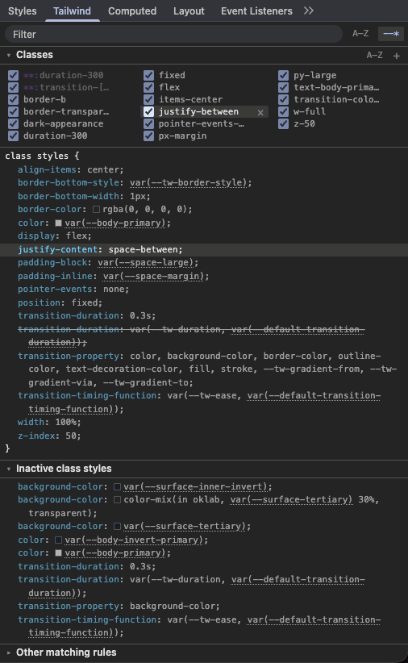

# Tailwind Styles

A Chrome DevTools extension that adds a **Tailwind** pane to the Elements sidebar. It shows every class-based style of the selected element in one view, next to a flat, always-visible class editor.

Built for Tailwind CSS v4 output (cascade layers, nested `@media` rules), but it works with any class-based CSS.



## Features

- All declarations that apply to the selected element, grouped by the class that produces them
- Flat class list that flows top-to-bottom in columns, with a toggle to sort by source order or A–Z
- `+` button in the header to add a class, with suggestions
- Hold **Shift** while hovering a style row or a class to highlight everything from the same class and dim the rest
- Collapsible sections, filter, and an option to hide CSS variables
- Matches the DevTools light/dark theme using DevTools' own design tokens

## Install

There's no build step.

1. Clone this repo.
2. Open `chrome://extensions` and enable **Developer mode**.
3. Click **Load unpacked** and select this folder.
4. Open DevTools, go to **Elements**, and pick the **Tailwind** tab in the sidebar.

## Development

| File | Purpose |
| --- | --- |
| `manifest.json` | Manifest V3 definition |
| `devtools.html`, `devtools.js` | Registers the sidebar pane |
| `panel.html`, `panel.css`, `panel.js` | The pane UI |
| `inspected.js` | Code evaluated in the inspected page to read matched rules |
| `harness.html`, `harness/` | Standalone test page and stub for developing the pane outside DevTools |
| `vendor/devtools/` | Vendored DevTools design tokens |

After editing, reload the extension on `chrome://extensions` and reopen DevTools.

### Updating the vendored DevTools tokens

```sh
node scripts/sync-devtools-styles.mjs           # pinned version
node scripts/sync-devtools-styles.mjs latest    # newest chrome-devtools-frontend
```

The files in `vendor/devtools/` are downloaded unmodified from the `chrome-devtools-frontend` npm package.

## License

[MIT](LICENSE). The files in `vendor/devtools/` are BSD-3-Clause, © The Chromium Authors; see [`vendor/devtools/LICENSE`](vendor/devtools/LICENSE).
